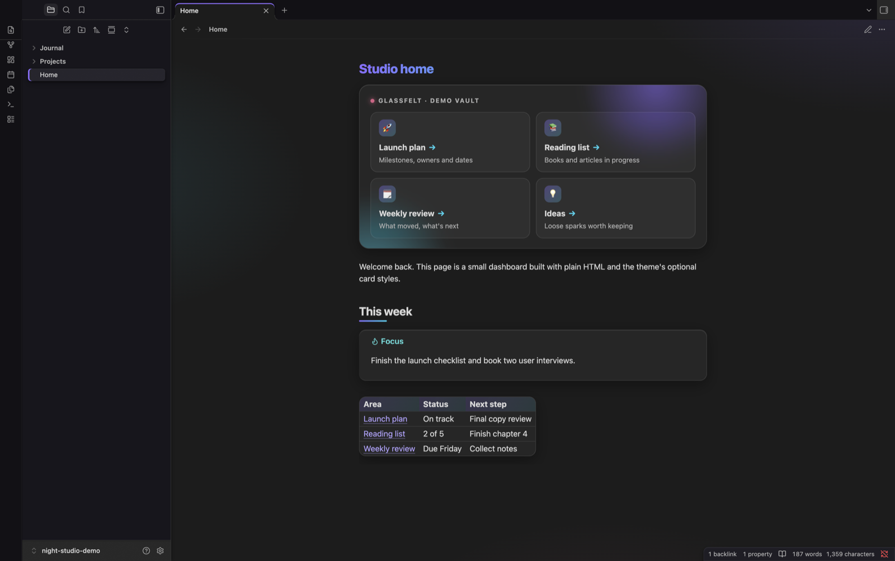
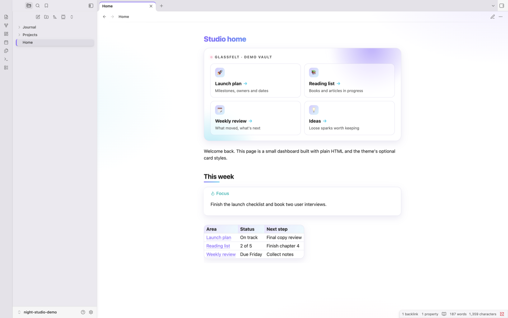

# Glassfelt

A dark, matte, tactile frame around a glassy, softly lit note area. Works in dark and light mode.



## What it does

**The frame (sidebars, tabs, menus)**
- Matte charcoal panels with a fine grain, soft elevation shadows and dark seams.
- Tactile controls: icons and file rows rise on hover and press in when clicked.
- The open file and active tab sit as raised slabs with a violet edge.
- Menus, the command palette and link previews are solid matte cards.

**The notes**
- A soft violet, cyan and pink wash behind every note.
- Frosted glass tables, callouts, embeds, code blocks and Bases views.
- Gradient page titles and short gradient bars under section headings.
- Notes fade in when opened; tables, callouts and embeds lift gently on hover.

**Accent:** violet by default. If you choose your own accent colour in Settings → Appearance, yours wins for buttons and links.

**Motion:** all animation switches off when your system's "Reduce motion" setting is on.



## Adjust it

Install the free **Style Settings** community plugin (Settings → Community plugins → Browse → "Style Settings"), then open Settings → Style Settings → Glassfelt. You can change:

- **Colours:** the main, second and highlight colours, separately for light and dark mode.
- **Note area:** background wash strength, glass tint and blur, corner roundness, home card width, plain page titles.
- **Frame:** the outer frame, sidebar and raised-surface colours, and the grain texture.
- **Motion:** turn off all motion, or just the note fade-in, the hover lift or the drifting header glows.

Everything works without the plugin; it only adds the controls.

## Install

Settings → Appearance → Themes → Manage → search "Glassfelt" → Install and use.

Manual: copy `theme.css` and `manifest.json` into `<your vault>/.obsidian/themes/Glassfelt/`, then pick it in Settings → Appearance.

## Optional: dashboard header and cards

The theme includes styles for a dashboard-style header with link cards (shown at the top of the screenshots). To use them on a note:

1. Add this to the note's properties:

   ```yaml
   ---
   cssclasses:
     - vault-dashboard
   ---
   ```

   `vault-dashboard` also hides the properties box on that note.

2. Paste this HTML into the note and change the links and text:

   ```html
   <div class="vt-hero">
   <div class="vt-kicker">My vault · home</div>
   <div class="vt-cards">
   <a class="internal-link vt-card" href="Projects/Launch plan.md"><span class="vt-card-icon">🚀</span><span class="vt-card-title">Launch plan</span><span class="vt-card-text">Milestones, owners and dates</span></a>
   <a class="internal-link vt-card" href="Ideas.md"><span class="vt-card-icon">💡</span><span class="vt-card-title">Ideas</span><span class="vt-card-text">Loose sparks worth keeping</span></a>
   </div>
   </div>
   ```

   Each `href` is the path to a note from the vault's root folder.

## Licence

MIT. See [LICENSE](LICENSE).
